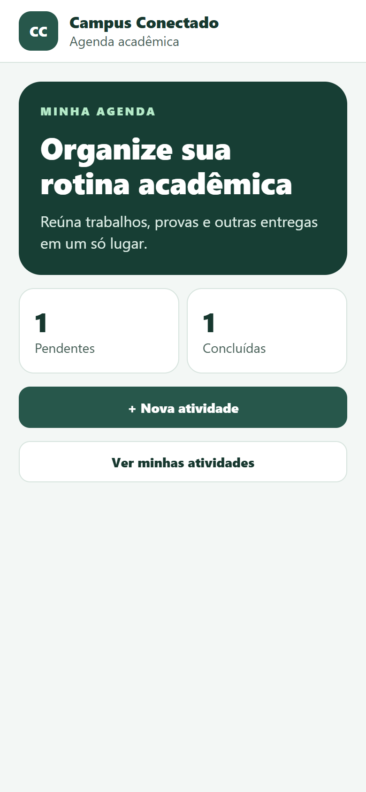
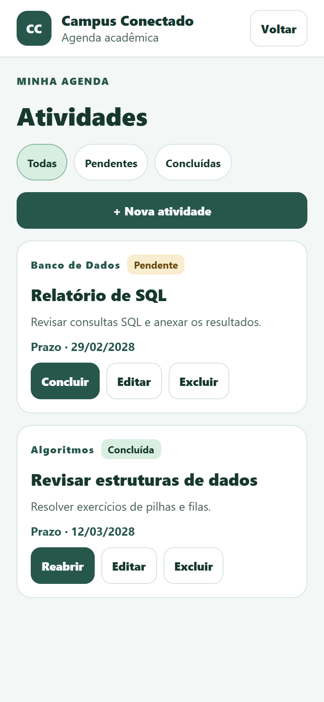
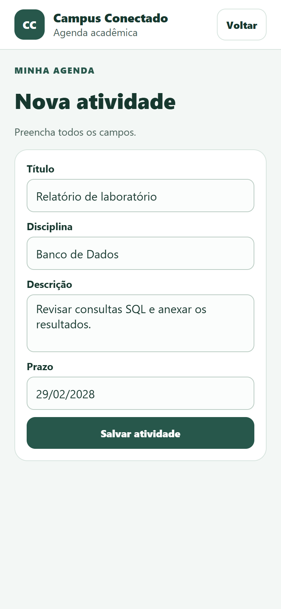

# Campus Conectado

Agenda acadêmica para registrar trabalhos, provas e outras entregas. O aplicativo reúne atividades pendentes e concluídas e guarda a agenda no dispositivo.

## Executar no celular ou emulador

1. Instale o Node.js 22.18 ou superior, de preferência uma versão LTS.
2. Na pasta do projeto, execute:

   ```sh
   npm ci
   npm start
   ```

3. No celular, use uma versão do Expo Go compatível com o SDK 54 e leia o QR code. Mantenha o celular e o computador na mesma rede. No Android, você também pode iniciar um emulador no Android Studio e pressionar **a** no terminal do Expo.

O projeto usa React Native, TypeScript, Expo SDK 54 e AsyncStorage. A documentação do Expo explica como [obter uma versão compatível do Expo Go](https://docs.expo.dev/troubleshooting/expo-go-version-mismatch/).

## Executar no navegador

```sh
npm run web
```

A versão web guarda seus dados no navegador e permite experimentar os mesmos fluxos.

## Verificar

```sh
npm run typecheck
npm test
```

- [Requisitos, protótipo e reflexão](docs/planejamento.md)
- [Evidências de teste e roteiro de demonstração](docs/verificacao.md)

## Telas

Capturas da versão web em viewport móvel, com dados de demonstração.

| Início | Atividades | Formulário |
| --- | --- | --- |
|  |  |  |

